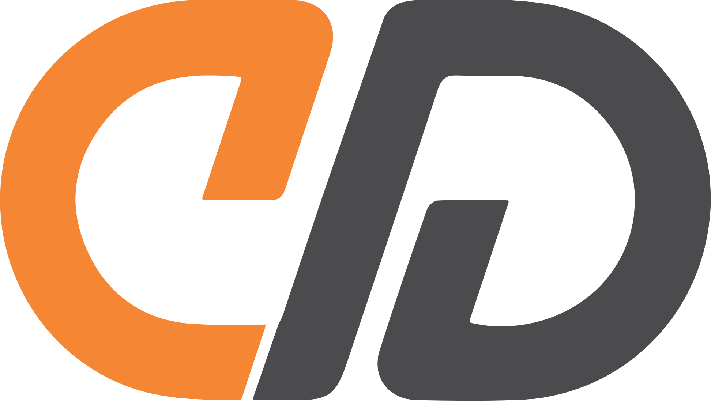

<!-- README.md is generated from README.Rmd. Please edit that file -->

# contabilidados.github.io



Repositório do site do **ContabiliDados**, grupo de pesquisa em
contabilidade, finanças e análise de dados do curso de Ciências
Contábeis da Universidade Federal Rural do Semi-Árido (UFERSA).

**Site:** <https://contabilidados.com.br>

<!-- badges: start -->

**Status:**
[](https://contabilidados.com.br)
[](https://github.com/contabilidados/contabilidados.github.io/actions/workflows/pages/pages-build-deployment)
[](https://github.com/contabilidados/contabilidados.github.io/commits/main)
[](https://github.com/contabilidados/contabilidados.github.io/graphs/commit-activity)
[](https://github.com/contabilidados/contabilidados.github.io/issues)

**Tecnologia:** [](https://quarto.org/)
[](https://www.r-project.org/)
[](https://github.com/contabilidados/cntdd)
[](https://pages.github.com/)
[](https://giscus.app/)
[](https://github.com/contabilidados/contabilidados.github.io)

**Projeto:**
[](https://contabeis.ufersa.edu.br)
[](https://dgp.cnpq.br/dgp/espelhogrupo/480677)
[](https://github.com/contabilidados/contabilidados.github.io/graphs/contributors)
[](https://creativecommons.org/licenses/by-sa/4.0/deed.pt-br)
[](https://www.instagram.com/contabilidados)
[](https://www.youtube.com/watch?v=Bckx1xIqGto&list=PL2Kz0fa0V_r3ghh1iHWl31CYr5bVc0Jfo)
[](https://github.com/contabilidados/contabilidados.github.io/stargazers)

<!-- badges: end -->

O projeto reúne textos de divulgação científica, eventos, o pacote R
[`cntdd`](https://github.com/contabilidados/cntdd) e ferramentas de
apoio ao ensino e à pesquisa, como o **Links DFs CVM**, repositório de
links para os documentos das companhias abertas (DFP, ITR, FRE, FCA e
Informe de Governança).

------------------------------------------------------------------------

## Seções do site

| Seção | Fonte | Conteúdo |
|----|----|----|
| Home | `index.qmd` | Abertura, posts recentes, áreas temáticas, eventos e pacote `cntdd` |
| Posts | `posts.qmd` e `posts/` | Textos organizados em Contabilidade, Finanças e Análise de Dados, com abas e busca |
| Eventos | `meetings.qmd` e `eventos/` | Palestras, minicursos e participações em congressos |
| cntdd | `cntdd.qmd` e `pacotes/` | Documentação e exemplos do pacote `cntdd` |
| Dashboard | menu do `_quarto.yml` | Links DFs CVM (`cntdd_linksDFS/`), Indicadores e Mercado de Trabalho |
| Sobre | `membros.qmd` e `curriculum/` | Apresentação do grupo e perfis de professores e alunos |

## Estrutura do repositório

| Pasta ou arquivo | Função |
|----|----|
| `_quarto.yml` | Configuração do site: menu, rodapé, temas, comentários (giscus), compartilhamento e analytics |
| `styles.css` e `dark.css` | Estilos dos modos claro e escuro (cores do logo, cartões, rodapé, tipografia) |
| `_templates/` | Modelos EJS das listagens da home e da página Posts |
| `assets/fontes/` | Montserrat auto-hospedada (títulos e logotipo), com licença OFL |
| `assets/leitura.js` | Modo leitura dos posts: tamanho da letra, fundo sépia, espaçamento, foco e barra de progresso |
| `posts/<área>/<nome>/` | Um post por pasta; áreas: `contabil`, `finance` e `dados` |
| `eventos/<nome>/` | Um evento por pasta |
| `pacotes/` | Páginas do pacote `cntdd` |
| `curriculum/profs/` e `curriculum/alunos/` | Perfis dos membros, com fotos em `figs/` |
| `cntdd_linksDFS/` | App estático Links DFs CVM (HTML, JavaScript e dados em JSON) |
| `share.png` | Imagem exibida ao compartilhar o site em redes sociais e no WhatsApp |
| `docs/` | Site gerado pelo Quarto e publicado pelo GitHub Pages (não editar à mão) |

## Como publicar alterações

1.  Edite os arquivos `.qmd`, `.css` ou o `_quarto.yml`.

2.  Gere o site com o [Quarto](https://quarto.org/) (versão 1.6 ou
    superior; o site atual foi gerado com a 1.10):

    ``` bash
    quarto render
    ```

3.  Confira o resultado com `quarto preview` e envie as alterações,
    incluindo a pasta `docs/`:

    ``` bash
    git add -A
    git commit -m "Descrição da alteração"
    git push
    ```

O GitHub Pages publica a pasta `docs/` da branch `main` no domínio
`contabilidados.com.br` (arquivo `CNAME`) em cerca de um minuto. Para
atualizar uma única página, basta `quarto render caminho/da/pagina.qmd`.

## Como adicionar conteúdo

### Post

Crie a pasta `posts/<área>/<nome>/` com o arquivo `<nome>.qmd` e a
imagem de capa:

``` yaml
---
title: "Título do post"
author: "Nome do autor"
date: 2026-11-18
description: "Resumo de uma ou duas frases, usado no Google e nos compartilhamentos."
categories:
  - Finanças
  - Governança
image: "capa.jpg"
image-alt: "Descrição da imagem de capa"
toc: true
---
```

A área (`contabil`, `finance` ou `dados`) é definida pela pasta. O post
aparece sozinho na home, na página Posts e na contagem da área. Prefira
imagens de capa em JPG ou WebP com até 1200 px de largura.

### Membro

Crie `curriculum/profs/<nome>.qmd` ou `curriculum/alunos/<nome>.qmd` e
coloque a foto em `figs/`. A primeira categoria indica o grupo e não
aparece no cartão:

``` yaml
---
title: "Nome Sobrenome"
comments: false
image: figs/nome.jpg
categories:
  - Professores
  - Contabilidade
  - Finanças
about:
  template: trestles
  links:
    - icon: envelope
      text: Email
      href: mailto:email@exemplo.com
    - icon: file-pdf
      text: Lattes
      href: http://lattes.cnpq.br/0000000000000000
---

Texto de apresentação em primeira pessoa.
```

A foto aparece redonda, e os cartões são ordenados alfabeticamente pelo
`title`.

### Evento

Crie a pasta `eventos/<nome>/` com o `.qmd` do evento. Os campos
`date_publish` (AAAA-MM-DD), `date_event` e `location` alimentam os
cartões da home, que mostram o selo “Próximo” ou “Realizado” conforme a
data.

## Links DFs CVM

O app em `cntdd_linksDFS/` funciona sem servidor: os dados ficam em
arquivos JSON e a busca roda no navegador. A atualização com a base de
Dados Abertos da CVM é feita toda segunda-feira por GitHub Actions, a
partir de um repositório privado que guarda o código-fonte, o script R
de coleta e o fluxo de trabalho. Não é preciso editar esses dados à mão.

## Créditos e licença

O conteúdo está sob a licença [Creative Commons
Atribuição-CompartilhaIgual 4.0 (CC BY-SA
4.0)](https://creativecommons.org/licenses/by-sa/4.0/deed.pt-br). O site
foi adaptado do modelo de [Beatriz Milz](https://beamilz.com/). As
fontes Montserrat seguem a [SIL Open Font
License](assets/fontes/OFL-Montserrat.txt).

**Contato:** <contabilidados@ufersa.edu.br> ·
[Instagram](https://www.instagram.com/contabilidados) ·
[YouTube](https://www.youtube.com/watch?v=Bckx1xIqGto&list=PL2Kz0fa0V_r3ghh1iHWl31CYr5bVc0Jfo)
· [Grupo no CNPq](https://dgp.cnpq.br/dgp/espelhogrupo/480677)
