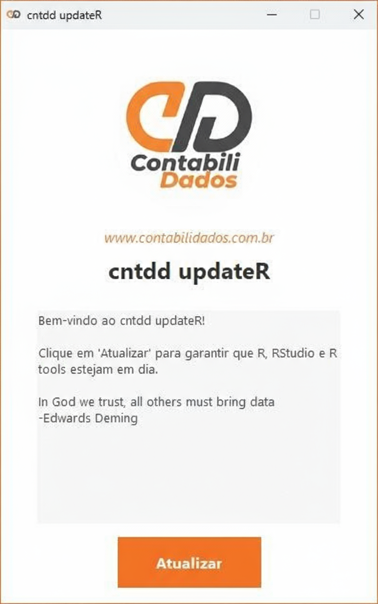

```{r setup, include=FALSE}
knitr::opts_chunk$set(echo = TRUE, include = TRUE, message = FALSE, warning = FALSE, comment = NA, fig.align = "center", out.width = "100%")
```


{fig-align="center" width="250"}

## 💡 O que o programa **cntdd updateR** faz?

Se você usa o **R** ou o **RStudio** no seu computador, sabe que manter
tudo atualizado pode dar um certo trabalho.\
Pensando nisso, criamos o **cntdd updateR** — um assistente gráfico que
atualiza automaticamente todo o seu ambiente R com apenas **um clique**.

Ele verifica, instala e atualiza automaticamente:

-   🧠 **R (linguagem de programação)** – o coração das suas análises de
    dados;\
-   💻 **RStudio (ambiente de desenvolvimento)** – onde você escreve e
    executa seus scripts;\
-   🛠 **Rtools (ferramentas de compilação)** – necessárias para instalar
    pacotes mais avançados.

E não para por aí: depois de cuidar dos programas, o **cntdd updateR**
ainda atualiza **todos os pacotes instalados no R**, direto do **CRAN**,
garantindo que o seu ambiente esteja limpo, estável e com as versões
mais recentes.

## ⚙️ Como ele funciona por dentro

O programa foi desenvolvido em **Python**, com interface gráfica feita
em **Tkinter**, para ser leve e intuitivo.\
Ele utiliza o **Winget**, o gerenciador oficial de aplicativos do
Windows, para buscar, instalar e atualizar os componentes necessários —
tudo de forma automática, sem janelas de terminal nem downloads manuais.

Durante o processo, o usuário acompanha cada etapa em uma janela clara e
organizada, com mensagens que explicam o que está sendo feito.

## 🖱️ Como usar o cntdd updateR

1.  Clique com o **botão direito do mouse** sobre o arquivo do
    programa.\
2.  Selecione **“Executar como administrador”**.\
3.  Clique em **“Atualizar”** e aguarde o processo.

> ⚠️ **Importante:** o programa precisa ser executado **como
> administrador**, pois ele realiza atualizações de aplicativos no
> sistema e acessa pastas protegidas (como o diretório de instalação do
> R em `C:\Program Files`).

Ao final, o **cntdd updateR** mostrará uma mensagem informando que tudo
foi atualizado com sucesso — o R, o RStudio, o Rtools e todos os seus
pacotes estarão prontos para uso.

::: {style="text-align: center; margin-top: 30px;"}
<a href="http://getcntddupdatergui.netlify.app/cntddupdateR.exe" 
     download 
     style="background-color:#F57224; color:#fff; padding:12px 24px; text-decoration:none; border-radius:8px; font-weight:bold; font-size:16px;">
⬇️ Baixar cntdd updateR </a>
:::

> Caso o dowload seja bloqueado pelo pop-up do navegador:
>
> 1\. Clicar com botão direito do mouse em *Baixar cntdd update*
>
> 2\. Depois escolha *Salvar link como...*
